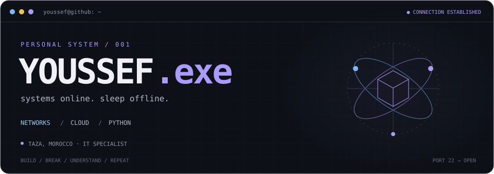
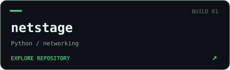
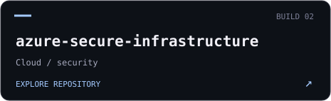
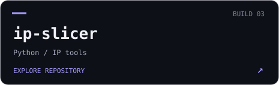
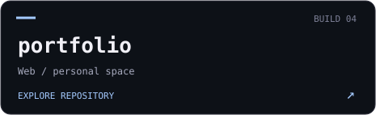
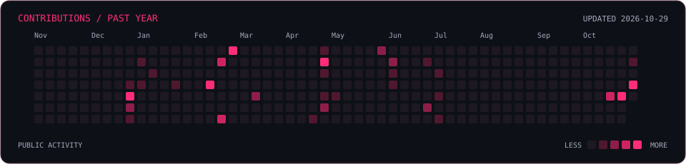

  

  

### / about

~~~python
youssef = {
    "location": "Night City",
    "role": "Cybersecurity, Cloud & AI Student",
    "education": "Final-year bachelor's",
    "field": ["Cybersecurity", "Cloud Computing", "Artificial Intelligence"],
    "interests": ["Cloud Security", "Penetration Testing", "AI & Machine Learning"],
    "projects": ["netstage", "ip-slicer", "azure-secure-infrastructure"],
}
~~~

### / stack

  
    
  
  
  
  

### / projects

  
  
  
  

### / connect

  
  
  

### / activity

  

